# Reproducing "Vision Transformers Need Registers"

Course project (Machine Learning, IBA Karachi): paper reproduction, experiment and deployment.
Team Members: Hamza Uzair (30544), Shaheer Ahmed (31543)

**Paper:** T. Darcet, M. Oquab, J. Mairal, P. Bojanowski. *Vision Transformers Need Registers.* ICLR 2024 (oral). [arXiv:2309.16588](https://arxiv.org/abs/2309.16588)

[](https://github.com/recommended131225435/vit-registers-reproduction/actions/workflows/tests.yml)
[](https://colab.research.google.com/github/recommended131225435/vit-registers-reproduction/blob/main/notebooks/milestone2_colab.ipynb)

> **Branches.** `main` (this page): reproduction, deployment, final report and presentation.
> **[`experiment-model-size`](https://github.com/recommended131225435/vit-registers-reproduction/tree/experiment-model-size): the Milestone 3 experiment** (section 7) on its own, on top of the reproduction milestone: the measurement code, the Colab notebook, the tests, all 12 training runs and their results.
> `main` also contains the experiment's code and results, because the final report and the app use them.

## Results at a glance

| Paper claim | Paper | Ours | Reproduced? |
|---|---|---|---|
| Large ViTs contain a few patch tokens with a very high norm | Fig 3: 2.37% of ViT-g tokens | 2.62% of ViT-g tokens | **Yes** |
| These tokens sit on redundant (background) patches | Fig 5a | Neighbour similarity 0.871 vs 0.662 | **Yes** |
| Registers remove them | Fig 7 | 2.62% → 0.00% | **Yes** |
| Registers give clean attention maps | Fig 1 | Same visual result (section 6) | **Yes** |
| The high norms move into the registers | Fig 15 | One register at 1389.6 vs 107.8 for a typical patch | **Yes** |
| High-norm tokens only appear in large models | Fig 4c: from ViT-L up | Only in ViT-g (released S/B/L are distilled) | **Partly** |
| *Our experiment:* small ViTs trained from scratch have no high-norm tokens | (Fig 4c: none below ViT-L) | 0.00% outliers in all six of our models (5M–85M parameters) | **Consistent** |
| Registers do not hurt accuracy | Table 2a: −0.1 to +0.5 points | −0.81 / +0.44 / −0.66 points (our Tiny / Small / Base), one seed each | **Mostly** |
| *Our finding:* without artifacts, registers are not used | — | Patches give the registers 6.0% / 5.7% / 6.2% of their attention; chance level is 5.8% | new |
| Registers improve dense tasks and object discovery | Tables 2a, 3 | Not tested (see Limitations) | — |

**Milestones:** reproduction (sections 5–6), our own experiment on model size (section 7), a deployed web app (section 8), the final report (`report/report.pdf`) and presentation (`report/presentation.pptx`). The conclusion is in section 11.

## 1. The paper in short

Large Vision Transformers (DINOv2, CLIP, DeiT-III) show bright spots in their attention maps on empty background areas. The authors show these spots are patch tokens with a very large norm (about 10x normal). These tokens have lost the information about their own patch and instead hold information about the whole image. Their explanation: the model needs extra space for global computation, and without any, it takes over patches it considers useless. The fix is to add a few extra learnable tokens ("registers") to the input that the model can use as scratch space. These tokens are thrown away at the output. With registers, the artifacts disappear and dense tasks improve.

### Background and related work

**What came before.** A Vision Transformer (ViT, Dosovitskiy et al., 2021) cuts an image into patches, turns each patch into a token, and adds a [CLS] token that collects a summary of the whole image. Adding extra tokens to a transformer was already common, but usually to carry information in or to read a result out, like [CLS]. The closest idea to registers is the **Memory Transformer** (Burtsev et al., 2020), which added blank "memory" tokens to a language model and improved translation. Sandler et al. (2022) tried learnable memory tokens for fine-tuning ViTs, but found they did not transfer well between tasks.

For vision, the key background is self-supervised learning. **DINO** (Caron et al., 2021) showed that a ViT trained without labels produces clean attention maps that outline objects. **LOST** (Siméoni et al., 2021) used those maps to find objects without any labels. **DINOv2** (Oquab et al., 2024) gave much better features overall, but LOST worked poorly on it. That puzzle is the starting point of this paper. **MAE** (He et al., 2022), trained only to rebuild hidden patches, shows no artifacts.

**What was missing.** Nobody had explained why DINOv2, CLIP and supervised ViTs (DeiT-III) have noisy attention maps while DINO does not, or offered a fix. Earlier work treated extra tokens as an add-on to gain accuracy, not as a remedy for a problem inside the model.

**What this paper adds.**
1. A diagnosis: the artifacts are a small number (about 2%) of patch tokens with a very large norm. They appear on redundant background patches, only in large models trained for long, and they store global rather than local information.
2. An explanation: the model reuses useless patches as scratch space.
3. A simple fix: add a few "register" tokens that are thrown away at the output. With 4 registers this costs less than 2% extra compute, and it works across supervised, text-supervised and self-supervised training.

**What came after.** Meta released DINOv2 models with registers, which we use in Part A. Later work has questioned and extended the explanation:
- **Sun et al. (2024), "Massive Activations"**, find very large activations in both language models and ViTs. They argue these act as fixed bias terms inside attention, and describe registers as learned biases rather than storage for global information.
- **Yang et al. (2024), "Denoising Vision Transformers"**, study a different artifact: a grid-like pattern in ViT features that they trace to the position embeddings. They remove it after training with a small learned denoiser, and their method also improves DINOv2 models trained with registers. So registers do not fix every kind of artifact.
- **Jiang et al. (2025), "Vision Transformers Don't Need Trained Registers"**, find a few specific neurons that create the high-norm tokens. By moving those activations into one extra, untrained token at test time, they get most of the benefit of registers without retraining the model.

**How our project relates.** Part A repeats the paper's diagnosis on the released models. Our finding that the high norms are only visible before the final LayerNorm fits with this later work, which measures norms inside the network rather than on the final output. Part B asks whether the behaviour appears at all in small ViTs trained from scratch; the paper's size result (Fig 4c) suggests it may not.

## 2. What this repository does

| Part | What | Status |
|---|---|---|
| **A** | Reproduce the paper's diagnostic findings (Fig 1, 3, 4c, 5a, 7, 15) on the **official pretrained DINOv2 models**, with and without registers. No training needed. | Done: `scripts/run_part_a.py`, results in section 6 |
| **B** | **Our own ViT implementation with a register option**, a Tiny-ImageNet data pipeline, and a training script. Train small ViTs with 0 vs 4 registers. | Pipeline, model and forward pass done (24/24 checks). Two full 50-epoch runs done (0 vs 4 registers). Section 5. |
| Experiment | *Do high-norm artifacts appear in small ViTs trained from scratch, or only once models are large? Do registers change anything below that size?* | Done: ViT-Tiny/Small/Base × 0/4 registers, 50 epochs each. Section 7 |
| Deployment | FastAPI app: upload an image, get a class prediction from our ViT-Tiny and see DINOv2's attention and norm maps without vs with registers | Done, with tests. Section 8 |

### Metrics we use, and what they miss

| Metric | What it measures | What it does not tell us |
|---|---|---|
| **Token norm** (L2 length of a token vector) | How "loud" a token is; the paper's artifacts are about 10x louder than normal tokens | Why the model makes them; it depends on where it is measured (before or after the final LayerNorm, see section 6) |
| **% outlier tokens** | How common the artifacts are | Depends on the cutoff: the paper hand-picked 150 for ViT-g; we use 3x the model's median norm so every model is judged the same way |
| **Neighbour cosine similarity** (right after patch embedding) | Whether a patch looks like its 4 neighbours, i.e. is redundant background | Nothing about what the token contains later in the network |
| **[CLS] attention maps** | Where the model looks; artifacts show up as bright background spots | It is a picture, not a number, so it supports the other metrics rather than replacing them |
| **Top-1 validation accuracy** (Tiny-ImageNet, 200 classes) | How well our ViT classifies images it never trained on | Nothing about feature-map quality, which is where the paper says registers help most (segmentation, depth, object discovery) |

## 3. Repository structure

The code follows the ML pipeline, one file per stage:

```
src/
├── data.py        1. Data: download Tiny-ImageNet, preprocess, batch
├── vit.py         2. Model: our Vision Transformer with optional registers
├── train.py       3. Training + evaluation (AdamW, warmup + cosine LR, mixed precision, CSV logs)
├── analysis.py    4. Measurements from the paper: token norms, neighbour similarity, attention maps
├── plots.py       5. Figures
├── report.py      6. Writes results into this README
└── utils.py          Shared helpers (random seed, device, parameter count)

scripts/
├── check_forward_pass.py   data -> model -> loss -> gradients (24 checks)
├── run_part_a.py           Part A: analysis of pretrained DINOv2 models
├── summarise_training.py   Results table + graph for the full training runs
├── analyse_run.py          Experiment: measure artifacts in one of our trained models
├── summarise_experiment.py Experiment: tables + figures across all model sizes
└── export_model.py         Export a trained ViT-Tiny for the app

app/
├── main.py        FastAPI app: web page, /predict, /health, /docs
├── inference.py   model loading, prediction, attention and norm maps
├── static/        the web page
└── weights/       our exported ViT-Tiny models (0 and 4 registers)

tests/                      Unit tests for the model and the measurements
notebooks/milestone2_colab.ipynb   Runs everything for milestone 2 on Google Colab
notebooks/full_training_colab.ipynb Full 50-epoch training runs (0 vs 4 registers)
notebooks/experiment_colab.ipynb    Experiment: train ViT-Tiny/Small/Base, measure artifacts in all our models
.github/workflows/tests.yml         Runs the unit tests and a forward-pass check on every push
report/
├── report.pdf          final technical report (built by build_report.py from results/)
├── presentation.pptx   slides with speaker notes (built by build_slides.js from results/)
└── text.json           the discussion text used by both
results/
├── figures/     all plots
├── logs/        forward pass check report
├── part_a/      Part A numbers (summary.md, summary.json)
├── experiment/  experiment numbers per run (stats.json, arrays.npz) and summary.md
└── runs/        training logs (config.json, log.csv, final.json)
requirements.txt        minimum library versions
requirements-lock.txt   exact versions used on Colab (created by the notebook)
PROVENANCE.md           where every piece of code came from
```

### Workflow we followed


1. **Part A first.** Before training anything, we checked the paper's claims on the exact models it studied. This is cheap (about 20 minutes on a free GPU) and showed us how to measure the artifacts correctly: our first attempt measured after the final LayerNorm and found nothing, which we caught and fixed.
2. **Build and test the model before training.** Our ViT has 9 unit tests (for example: registers get no position embedding, and our step-by-step attention matches PyTorch's fast version).
3. **Forward pass on real data.** 24 automatic checks: data shapes, labels, a starting loss close to ln(200), gradients reaching the registers.
4. **Small run, then full run.** A 5-epoch run on 10% of the data to catch bugs quickly, then the full 50-epoch runs. Progress is saved after every epoch so a Colab disconnect never loses a run.
5. **Check the training curves before trusting the measurements.** When ViT-Base's accuracy collapsed at the learning rate of 1e-3, we did not measure the broken model and move on: we retrained all sizes at 2.5e-4 so the comparison stays fair, and kept the failed runs as a documented result (section 7).
6. **Everything is logged.** Every run saves its settings, a per-epoch log and its final result in `results/`, and the scripts write their results into this README. `PROVENANCE.md` records where each piece of code came from.

## 4. How to run

**Easiest: Google Colab.** Choose a T4 GPU runtime, then run all cells.

- [Milestone notebook](https://colab.research.google.com/github/recommended131225435/vit-registers-reproduction/blob/main/notebooks/milestone2_colab.ipynb): tests, forward-pass check, sanity runs and Part A (about 30–40 min).
- [Full training notebook](https://colab.research.google.com/github/recommended131225435/vit-registers-reproduction/blob/main/notebooks/full_training_colab.ipynb): the 50-epoch runs (about 75 min each; progress is saved to Google Drive, so it can be resumed).
- [Experiment notebook](https://colab.research.google.com/github/recommended131225435/vit-registers-reproduction/blob/main/notebooks/experiment_colab.ipynb): trains ViT-Small/Base and measures artifacts in all our models (section 7).

**By hand** (always from the repo root):

```bash
pip install -r requirements.txt
python -m pytest                                  # unit tests
python -m scripts.check_forward_pass              # downloads Tiny-ImageNet, checks data + forward pass
python -m scripts.run_part_a --sizes S,B,L,g      # Part A (GPU recommended)
python -m src.train --size tiny --registers 4 --epochs 50 --out results/runs/tiny_reg4   # a full training run
python -m scripts.analyse_run --run results/runs/tiny_reg4   # experiment: measure artifacts in a trained run
python -m scripts.summarise_experiment                       # experiment: tables + figures
uvicorn app.main:app --port 8000                             # the web app (section 8)
```

Every script has a quick code-test mode that uses random data instead of downloads (`--fake` or `--smoke`).

## 5. Part B: our ViT with registers

**Token sequence inside the transformer:**

```
[CLS] [REG_1] [REG_2] [REG_3] [REG_4] [PATCH_1] ... [PATCH_64]
  │      └──── learnable, no position ────┘  └─ 8x8 patches of a 64x64 image
  │           embedding, discarded at output
  └── used for classification
```

**Design choices:**

| Choice | Value | Why |
|---|---|---|
| Dataset | Tiny-ImageNet (100k train / 10k val, 200 classes, 64x64) | Freely downloadable, small enough for a free T4, 200 classes is harder than CIFAR. The official val set is our test set because test labels are not public. |
| Patch size | 8 → 8x8 = 64 patch tokens | Standard choice for 64x64 images |
| Model size | ViT-Tiny: 192-dim, 12 layers, 3 heads (5.4M params). ViT-Small (384-dim, 6 heads) and ViT-Base (768-dim, 12 heads) for the experiment. | Trains in reasonable time on a free GPU |
| Number of registers | 0 (baseline) and 4 | The paper uses 4 in all its main experiments (Sec 3.2) |
| Register placement | After the position embeddings, between [CLS] and patches, with no position embedding | Same as the official DINOv2 implementation |
| Register init | Normal, std 1e-6 (same as [CLS]) | Same as the official DINOv2 implementation |
| Output | Registers discarded; [CLS] → linear head | As in the paper (Fig 6) |
| Training | AdamW (lr 1e-3, wd 0.05), 5 warmup epochs + cosine decay, label smoothing 0.1, stochastic depth 0.1, random-resized-crop + flip, mixed precision | Standard DeiT-style recipe for training ViTs from scratch on small data |
| Strong augmentation (option, not used) | + RandAugment (2 edits, magnitude 9), random erasing (25%), MixUp (0.8) or CutMix (1.0) per batch | Implemented as the DeiT recipe's tools against overfitting. Off by default; we kept every run on the same basic recipe so the experiment changes only one thing (model size). |

### Forward pass check

Output of `python -m scripts.check_forward_pass` on the real dataset:

<!-- FORWARD_CHECK_START -->
Data: Tiny-ImageNet. Model: ViT-Tiny (192-dim, 12 blocks, 3 heads, 8x8 patches, 64 patch tokens). Batch size 64. Device `cuda` (Tesla T4), Python 3.13.15, torch 2.11.0+cu128.

| Check | Result | Detail |
|---|---|---|
| Train set size | PASS | 100,000 images |
| Val set size | PASS | 10,000 images |
| Train batch shape | PASS | (64, 3, 64, 64) |
| Val batch shape | PASS | (64, 3, 64, 64) |
| Labels in [0, 199] | PASS | min 0, max 197 |
| Pixels normalised (mean near 0, std near 1) | PASS | mean -0.110, std 1.170 |
| [0 reg] logits shape | PASS | (64, 200) |
| [0 reg] loss is finite | PASS | 5.3739 |
| [0 reg] starting loss close to ln(200) | PASS | 5.374 vs 5.298 |
| [0 reg] every parameter gets a finite gradient | PASS |  |
| [0 reg] sequence length = 1 + R + 64 | PASS | 65 = 1 + 0 + 64 |
| [0 reg] registers split off at output | PASS | reg (64, 0, 192), patch (64, 64, 192) |
| [0 reg] attention weights sum to 1 | PASS | attention shape (64, 3, 65, 65) |
| [0 reg] step-by-step attention == fast attention | PASS | max difference 4.8e-07 |
| [4 reg] logits shape | PASS | (64, 200) |
| [4 reg] loss is finite | PASS | 5.2905 |
| [4 reg] starting loss close to ln(200) | PASS | 5.291 vs 5.298 |
| [4 reg] every parameter gets a finite gradient | PASS |  |
| [4 reg] registers receive gradient | PASS | grad norm 2.59e+00 |
| [4 reg] sequence length = 1 + R + 64 | PASS | 69 = 1 + 4 + 64 |
| [4 reg] registers split off at output | PASS | reg (64, 4, 192), patch (64, 64, 192) |
| [4 reg] attention weights sum to 1 | PASS | attention shape (64, 3, 69, 69) |
| [4 reg] step-by-step attention == fast attention | PASS | max difference 9.5e-07 |
| Registers add exactly R x 192 parameters | PASS | 5,427,080 -> 5,427,848 (+768) |

**24/24 checks passed.**
<!-- FORWARD_CHECK_END -->

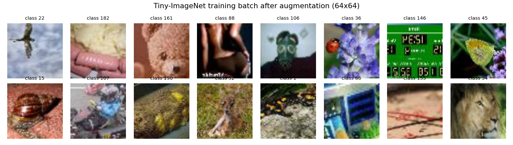

**Sanity training runs** (10k-image subset, 5 epochs, 0 vs 4 registers). These only show that the training loop learns. They are not results.

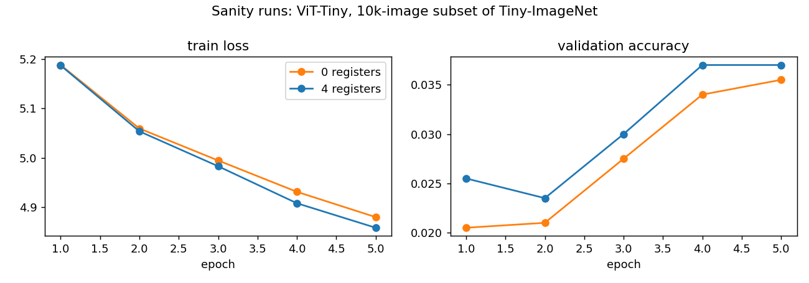

### Full training runs: 0 vs 4 registers

ViT-Tiny trained on all 100,000 Tiny-ImageNet training images for 50 epochs, without and with 4 registers, same settings and seed otherwise (basic augmentation: random crop and flip). Run with `notebooks/full_training_colab.ipynb`.

<!-- FULL_TRAINING_START -->
Validation accuracy after the last epoch (we do not pick the best epoch, because the validation set is also our test set).

| Model | Augmentation | Registers | Train images | Epochs | Val accuracy | Train accuracy | Val loss (final / lowest) | Time (min) |
|---|---|---|---|---|---|---|---|---|
| ViT-Tiny | basic | 0 | 100,000 | 50 | **38.99%** | 91.6% | 3.537 / 3.225 | 75 |
| ViT-Tiny | basic | 4 | 100,000 | 50 | **37.86%** | 91.5% | 3.592 / 3.246 | 75 |

- Effect of adding registers (basic augmentation): **-1.13 points**.
- Paper (Table 2a, ImageNet top-1): DeiT-III 84.7 → 84.7, OpenCLIP 78.2 → 78.1, DINOv2 84.3 → 84.8, i.e. registers do not hurt accuracy. Our absolute accuracies are not comparable with the paper's (different dataset, much smaller model, shorter training); only the with/without-registers differences are. Each setting was trained once (seed 0), so differences of a few tenths of a point may be random variation.
- How to read the overfitting columns: a large gap between train and validation accuracy, and a final validation loss well above its lowest value, both mean the model is memorising the training images.

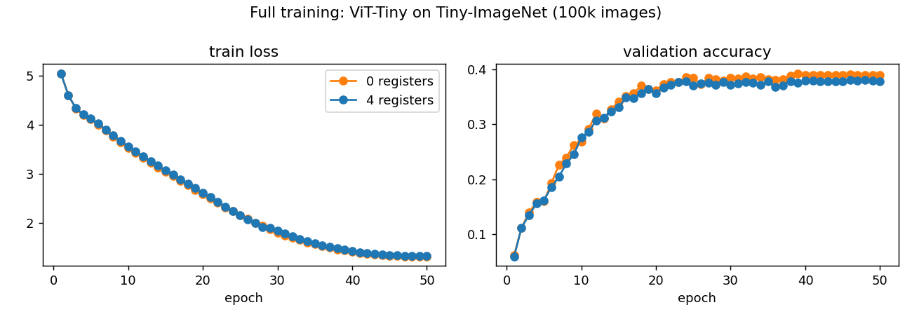
<!-- FULL_TRAINING_END -->

> **Update from the experiment (section 7).** These two runs used a peak learning rate of 1e-3. In the experiment we retrained every model at 2.5e-4, because 1e-3 broke ViT-Base. At 2.5e-4 our ViT-Tiny reaches 39.74% without and 38.93% with registers (−0.81 points), with much less overfitting (train accuracy about 73% instead of 91.5%). The app (section 8) still uses the two models below.

**What the training runs show**

- **Both models learn the same way.** The training-loss curves lie on top of each other, and both end at about 91.5% training accuracy.
- **Final validation accuracy: 38.99% without registers, 37.86% with 4 registers (−1.13 points).** The gap is steady rather than a one-epoch fluke: averaged over the last 10 epochs it is 38.99% vs 37.90%. Before epoch 20 the two runs are level, and the register model is even slightly ahead at epoch 10.
- **Compared with the paper:** at large scale the paper finds registers change ImageNet accuracy by −0.1 to +0.5 points (Table 2a). Our drop is larger, so this claim is only **partly** reproduced: there is no big accuracy cost, but we cannot rule out a small one.
- **Why we can't say more yet:** each setting was trained once (seed 0), and the register run was paused and resumed once after epoch 14, which changes the order of the training images afterwards. A 1-point gap can come from this kind of randomness alone; training a second seed of each setting would tell us.
- **A possible explanation, tested in section 7:** the paper reports that artifacts only appear in large models trained for a long time, so a ViT-Tiny on 64x64 images may have no artifacts at all, in which case registers have no job to do. The experiment confirms this: none of our models has artifacts, and the registers get only chance-level attention.
- **Both models overfit:** training accuracy (91.5%) is far above validation accuracy (38–39%), and validation loss is lowest around epoch 18 (3.23) before rising to 3.54 by epoch 50. This is typical for small ViTs trained from scratch on 100k images; stronger augmentation (MixUp, CutMix, RandAugment) would likely reduce it. We added these as an option but did not use them, so all our runs share one recipe. Since both runs here use identical settings, the comparison between them stays fair.

## 6. Part A: reproducing the paper's findings on pretrained DINOv2

We load Meta's released DINOv2 checkpoints (ViT-S/B/L/g with patch size 14, each with and without 4 registers). We run them on 256 Imagenette validation images, and measure:

| Paper claim | Paper evidence | Our evidence | Matches paper? |
|---|---|---|---|
| Some patch tokens have a much larger norm (two separate humps in the histogram) | Fig 3 | `part_a_norm_histograms.png` | **Yes.** ViT-g: 2.62% of tokens above 150 (paper: 2.37%) |
| Registers remove the outliers | Fig 7 | histograms + table below | **Yes.** ViT-g: 2.62% → 0.00% |
| Outliers sit on patches that are very similar to their neighbours | Fig 5a | `part_a_neighbour_cosine.png` | **Yes.** ViT-g: 0.871 vs 0.662 for normal patches |
| Registers give clean attention maps | Fig 1, 19 | `part_a_attention_maps.png` | **Yes** |
| With registers, the high norms move into the register tokens | Fig 15 | register-norm table below | **Yes.** ViT-g: one register at 1389.6 vs 107.8 for a typical patch |
| The outliers appear only in larger models | Fig 4c | `part_a_outliers_by_size.png` | **Partly.** Only ViT-g (and a tiny tail in ViT-B); the paper also finds them in ViT-L |

**How we find outliers:** We use the L2 norm (vector length) of each patch token at the output of the last transformer block, **before the model's final LayerNorm**. The final LayerNorm rescales every token to a similar length, which hides the outliers; our first run measured after it and found none (see `part_a_norm_histograms_after_layernorm.png`). A token is an outlier if its norm is more than 3 times the median norm of the same model. We judge each model against its own typical token because different models have very different typical norms. For ViT-g we also apply the paper's own hand-picked cutoff of 150.

**How we get attention maps:** A hook captures the input to the last attention layer. We recompute `softmax(q·kᵀ/√d)` and take the [CLS] row over the patch tokens, averaged over heads. We checked this against the DINOv2 module: recomputing the full attention output this way matches the module's own output to within 1e-7.

<!-- PART_A_START -->
Setup: official DINOv2 checkpoints (torch.hub), 256 Imagenette validation images at 224x224 (256 patches each). Norms are measured on the output of the last transformer block, before the final LayerNorm. An outlier is a patch token whose norm is more than 3 x the median norm of the same model.

| Model | Median norm (no reg / 4 reg) | Max norm (no reg / 4 reg) | % outliers, no reg | % outliers, 4 reg | Neighbour similarity, outlier vs normal (no reg) |
|---|---|---|---|---|---|
| ViT-S/14 | 20.1 / 58.8 | 29.7 / 88.6 | 0.00% | 0.00% | n/a vs 0.615 |
| ViT-B/14 | 53.9 / 138.9 | 252.2 / 216.8 | 0.20% | 0.00% | 0.884 vs 0.608 |
| ViT-L/14 | 84.7 / 254.8 | 145.2 / 420.4 | 0.00% | 0.00% | n/a vs 0.502 |
| ViT-g/14 | 49.6 / 107.8 | 560.6 / 286.7 | 2.62% | 0.00% | 0.871 vs 0.662 |

With the paper's own cutoff (norm > 150) on ViT-g: **2.62%** of patch tokens without registers (paper reports 2.37%). This cutoff is only meaningful for the no-register model, which is what the paper applied it to.

Why before the final LayerNorm: the LayerNorm rescales every token to a similar length. Largest token norm divided by the median norm:

| Model | before LayerNorm (no reg / 4 reg) | after LayerNorm (no reg / 4 reg) |
|---|---|---|
| ViT-S/14 | 1.48x / 1.51x | 1.17x / 1.28x |
| ViT-B/14 | 4.68x / 1.56x | 1.41x / 1.20x |
| ViT-L/14 | 1.71x / 1.65x | 1.24x / 1.19x |
| ViT-g/14 | 11.30x / 2.66x | 1.08x / 1.11x |

Average norms in the register models, before the final LayerNorm (where do the high norms go? cf. paper Fig 15b):

| Model | [CLS] | reg_0 | reg_1 | reg_2 | reg_3 | median patch |
|---|---|---|---|---|---|---|
| ViT-S/14 + reg | 42.7 | 43.9 | 159.8 | 42.4 | 40.1 | 58.8 |
| ViT-B/14 + reg | 132.7 | 104.5 | 230.1 | 104.5 | 284.5 | 138.9 |
| ViT-L/14 + reg | 196.7 | 762.2 | 128.1 | 170.0 | 170.4 | 254.8 |
| ViT-g/14 + reg | 150.9 | 299.2 | 150.7 | 1389.6 | 64.4 | 107.8 |

Figures: `results/figures/part_a_*.png`
<!-- PART_A_END -->

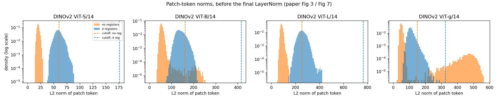
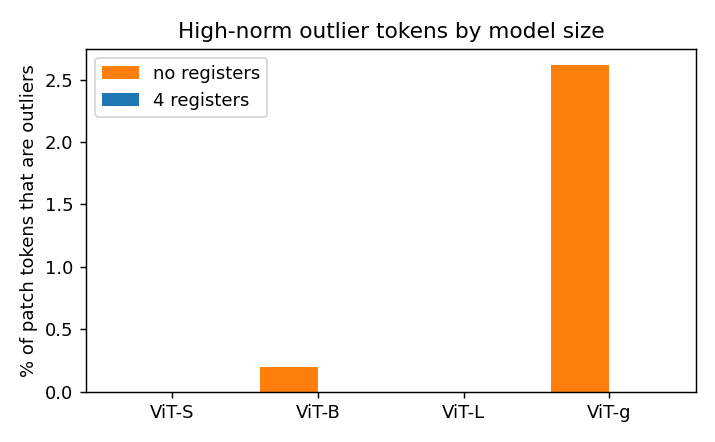
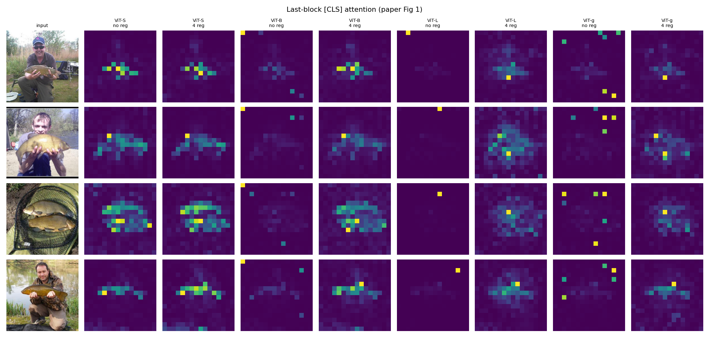
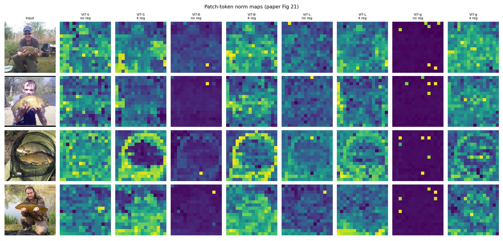
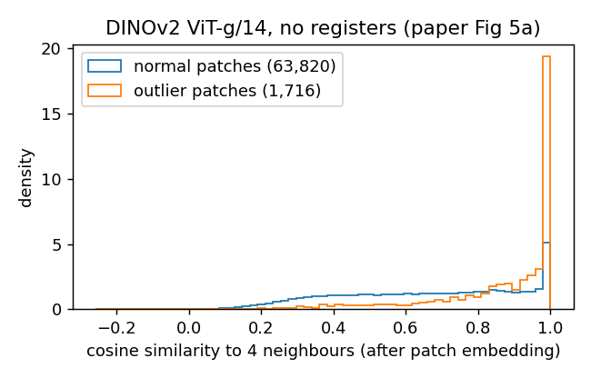
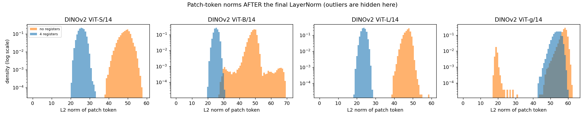

### What Part A shows

- **High-norm tokens (Fig 3): reproduced.** Without registers, ViT-g's patch-token norms form two separate humps: most tokens sit below 150, and a small group sits between roughly 300 and 560. 2.62% of tokens are above the paper's cutoff of 150; the paper reports 2.37%.
- **Registers remove them (Fig 7): reproduced.** With registers, ViT-g has no second hump and 0.00% outliers. The same holds for every model size.
- **Outliers sit on redundant patches (Fig 5a): reproduced.** Right after the patch embedding, ViT-g's outlier patches have an average similarity of 0.871 to their neighbours, against 0.662 for normal patches, with a sharp peak at 1.0 as in the paper. In ViT-B it is 0.884 vs 0.608.
- **Clean attention maps (Fig 1): reproduced.** Without registers, ViT-B, L and g show bright spots on background patches, often at the image edges. With registers, attention sits on the object. ViT-S is clean in both versions, in line with the paper's finding that small models don't have artifacts. The norm maps (Fig 21) show high-norm spots at the same positions as the attention spots.
- **High norms move into the registers (Fig 15): reproduced.** In every register model, one register has a clearly larger norm than a typical patch token. For example, ViT-g's reg_2 is at 1389.6 against 107.8 for the median patch, and ViT-L's reg_0 is at 762.2 against 254.8. As in the paper, the registers differ from each other.
- **Model size (Fig 4c): partly reproduced.** Clear high-norm outliers appear only in ViT-g; ViT-B has a very small tail (0.20%), and S and L have none. The paper finds outliers from ViT-L upwards. A likely reason: Meta's released S, B and L models were distilled from ViT-g, whereas the paper's Fig 4c trains each size on its own. ViT-L still shows attention-map artifacts, so the behaviour is weakened in it rather than fully absent.
- **The final LayerNorm hides the outliers.** In ViT-g the largest token is 11.3x the median norm before the final LayerNorm, but only 1.08x after it. The paper's norms must therefore be measured before this layer, which is what we do.

## 7. Experiment: do artifacts appear with model size?

**Question (one sentence):** do high-norm artifact tokens appear in small ViTs trained from scratch, or only once models are large enough, and do registers change anything below that size?

**Why this question.** The paper says artifacts appear only in large models trained for long (Fig 4c: from ViT-L upwards in DINOv2), but it shows this for one training method on hundreds of millions of images. Our own training budget allows only small models, so the useful question is what happens at the small end: are registers pointless there, or do small models already reuse tokens in a milder way?

**Type:** a model-size scaling study (the proposal's planned experiment), with registers as a second factor.

**Design.**

| | |
|---|---|
| What we change | Model size: ViT-Tiny (5.4M), ViT-Small (21.5M), ViT-Base (85.4M); each with 0 and with 4 registers |
| What we keep the same | Data (Tiny-ImageNet, 100k images), training recipe and length (50 epochs, section 5), peak learning rate 2.5e-4 (see below), seed, patch size |
| What we measure | Patch-token norms after every block (before the final LayerNorm), % outlier tokens (> 3x median, as in Part A), largest/median norm, how much attention goes to the registers, [CLS] attention maps, validation accuracy |
| Large-model reference | Meta's DINOv2 ViT-S/B/L/g from Part A, measured with the same rule, on the same size axis |
| Expected result if the paper's explanation holds | No outliers in our small models; registers receive little attention and change little; outliers only at the large end of the DINOv2 range |

**Learning rate.** We first trained every size with the learning rate of our ViT-Tiny runs (1e-3). ViT-Base did not train at that rate: validation accuracy peaked at 12.7–12.8% in epoch 2, fell to about 4% by epochs 13–15 after the learning rate reached its peak, and ended at 8.6% and 10.3% (both Base runs), and the token norms grew to about 8,000–11,000 instead of tens. ViT-Small with registers also trained badly (66.5% train accuracy, against 89.8% without registers). We therefore retrained all six models at **2.5e-4**, which is what DeiT's rule (5e-4 × batch size / 512) gives for our batch size of 256, so that every model again shares one recipe. The 1e-3 runs are kept and reported in a separate table below; they are not used in the figures.

**Measurement techniques.** All measurements are taken on the same fixed 2,000 validation images (random subset, seed 0) for every model. A forward pass is run block by block so the patch-token norms can be read after every block, before the final LayerNorm (Part A showed that this LayerNorm hides the outliers). The last block's attention is recomputed from its query/key weights to get (a) the [CLS] attention map and (b) the share of attention that patches and [CLS] send to the registers, which we compare with the share they would get if attention were spread evenly (4 of 69 tokens = 5.8%). Unit tests in `tests/test_analysis.py` check that the recomputed attention matches the model's own attention, and that these measurements return one value per block and valid attention shares.

Run with `notebooks/experiment_colab.ipynb` (`scripts.analyse_run`, then `scripts.summarise_experiment`).

<!-- EXPERIMENT_START -->
Our models: analysed on the same 2,000 Tiny-ImageNet validation images. Norms are taken before the final LayerNorm; an outlier is a patch token whose norm is more than 3x the median norm of the same model (same rule as Part A).

| Model | Parameters | Registers | Peak LR | Val accuracy | Train accuracy | Median norm | Largest / median | % outliers | Peak largest/median over blocks | Patch attention to registers (uniform) |
|---|---|---|---|---|---|---|---|---|---|---|
| ViT-Tiny | 5.4M | 0 | 0.00025 | 39.74% | 73.9% | 7.8 | 2.61x | 0.00% | 3.19x | n/a |
| ViT-Tiny | 5.4M | 4 | 0.00025 | 38.93% | 73.2% | 7.9 | 2.64x | 0.00% | 3.10x | 6.0% (5.8%) |
| ViT-Small | 21.5M | 0 | 0.00025 | 39.69% | 97.2% | 22.2 | 2.04x | 0.00% | 2.61x | n/a |
| ViT-Small | 21.5M | 4 | 0.00025 | 40.13% | 97.3% | 22.6 | 2.17x | 0.00% | 2.69x | 5.7% (5.8%) |
| ViT-Base | 85.4M | 0 | 0.00025 | 40.44% | 99.0% | 85.2 | 2.32x | 0.00% | 2.50x | n/a |
| ViT-Base | 85.4M | 4 | 0.00025 | 39.78% | 99.0% | 96.1 | 2.39x | 0.00% | 2.54x | 6.2% (5.8%) |

Runs not used in the figures (same recipe, other peak learning rate; see the discussion below):

| Model | Parameters | Registers | Peak LR | Val accuracy | Train accuracy | Median norm | Largest / median | % outliers | Peak largest/median over blocks | Patch attention to registers (uniform) |
|---|---|---|---|---|---|---|---|---|---|---|
| ViT-Tiny | 5.4M | 0 | 0.001 | 38.99% | 91.6% | 37.6 | 2.09x | 0.00% | 2.31x | n/a |
| ViT-Tiny | 5.4M | 4 | 0.001 | 37.86% | 91.5% | 40.2 | 1.84x | 0.00% | 2.26x | 4.1% (5.8%) |
| ViT-Small | 21.5M | 0 | 0.001 | 33.35% | 89.8% | 442.2 | 1.67x | 0.00% | 1.85x | n/a |
| ViT-Small | 21.5M | 4 | 0.001 | 30.60% | 66.5% | 646.1 | 1.98x | 0.00% | 2.36x | 1.5% (5.8%) |
| ViT-Base | 85.4M | 0 | 0.001 | 8.59% | 8.9% | 11175.5 | 1.49x | 0.00% | 1.64x | n/a |
| ViT-Base | 85.4M | 4 | 0.001 | 10.27% | 10.8% | 7924.1 | 1.45x | 0.00% | 1.58x | 16.4% (5.8%) |

Meta's DINOv2 models (from Part A), on the same axis:

| Model | Parameters | % outliers (no reg / 4 reg) | Largest / median (no reg / 4 reg) |
|---|---|---|---|
| DINOv2 ViT-S/14 | ≈21M | 0.00% / 0.00% | 1.48x / 1.51x |
| DINOv2 ViT-B/14 | ≈86M | 0.20% / 0.00% | 4.68x / 1.56x |
| DINOv2 ViT-L/14 | ≈300M | 0.00% / 0.00% | 1.71x / 1.65x |
| DINOv2 ViT-g/14 | ≈1100M | 2.62% / 0.00% | 11.30x / 2.66x |

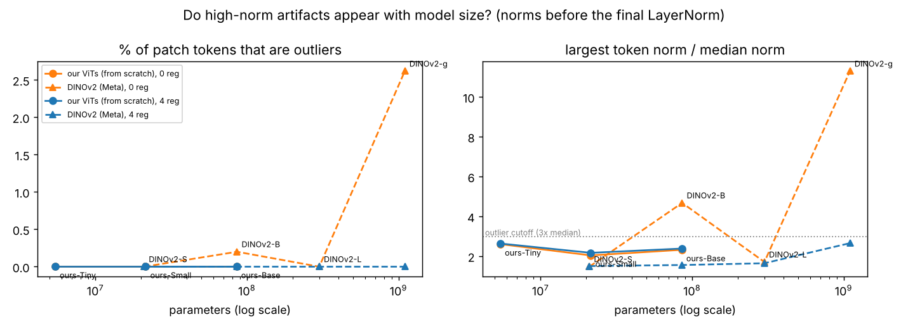

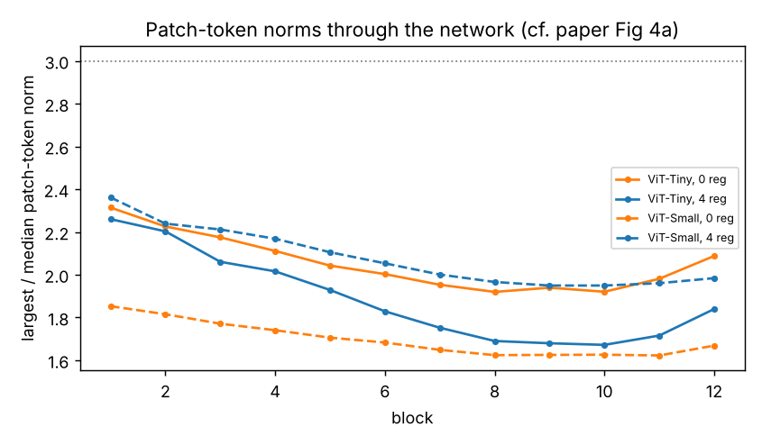

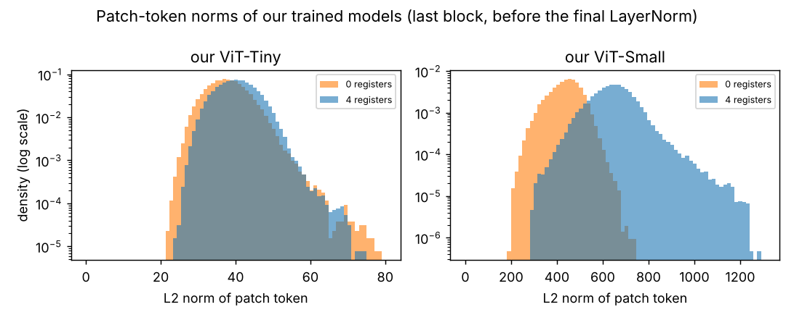

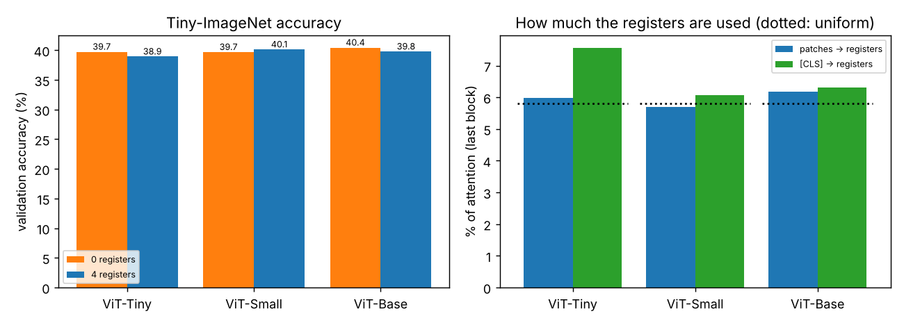

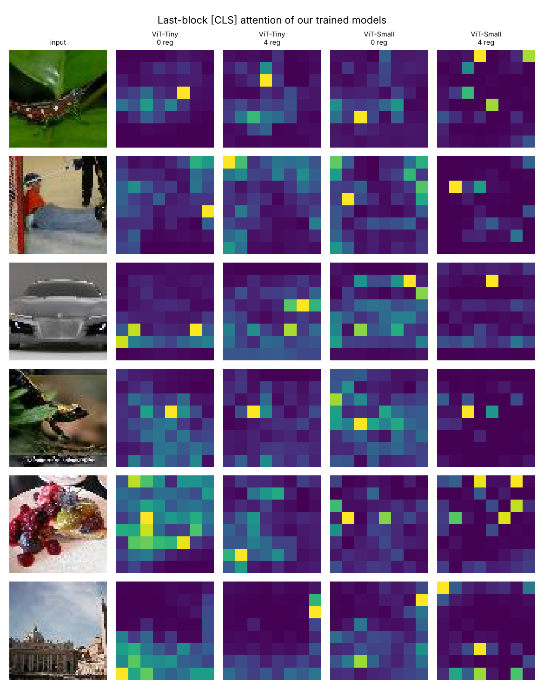

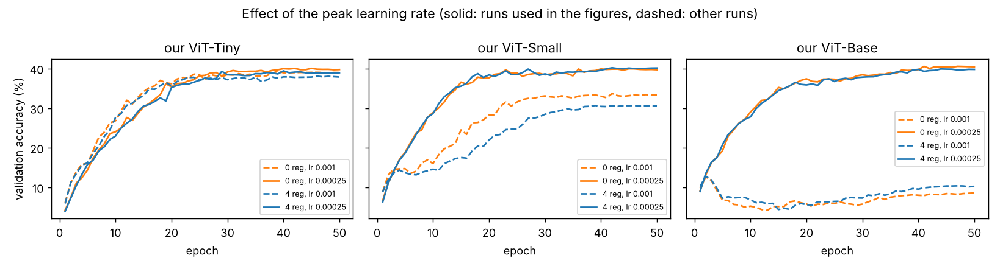
<!-- EXPERIMENT_END -->

### What the experiment shows

- **No artifacts in any of our models.** None of the six models has a single outlier token in its last block, where the paper measures them; there the largest token is at most 2.64x the median (the outlier line is 3x). The norm histograms have one hump, not the two humps of DINOv2 ViT-g (Part A). The only tokens above 3x in any block are a handful in the first two blocks of ViT-Tiny (largest 3.19x; 0.002–0.005% of tokens, about 3–6 of 128,000); they disappear by the third block, the opposite of the paper's artifacts, which appear in the middle of the network and grow towards the output (paper Fig 4a).
- **So the answer to our question is: they do not appear at this scale.** Combined with Part A, artifacts show up clearly only at the very top of the size axis (DINOv2 ViT-g, 1.1B parameters), with a small tail in DINOv2 ViT-B. Our largest model has the same size as DINOv2 ViT-B, but was trained on 100,000 small images for 50 epochs instead of 142 million images; the paper (Fig 4b, 4c) reports that artifacts need both a large model and long training, and our results agree with that.
- **Without artifacts, the registers are not used.** Patch tokens give the four registers 6.0% (Tiny), 5.7% (Small) and 6.2% (Base) of their last-block attention, and [CLS] gives them 7.6% / 6.1% / 6.3%. If attention were spread evenly, four tokens out of 69 would get 5.8%. So the registers receive about as much attention as an average token, and their norms are close to a typical patch's (ViT-Base: 79–98 against a median patch of 96): the model has nothing special to store in them. In DINOv2 ViT-g with registers, by contrast, one register holds a norm 13 times that of a typical patch (Part A).
- **Registers barely change accuracy.** Adding 4 registers changes validation accuracy by −0.81 (Tiny), +0.44 (Small) and −0.66 (Base) points. The paper reports −0.1 to +0.5 at ImageNet scale. Our differences are all under one point, have no consistent sign, and come from one seed each, so we read them as no clear effect either way (a small cost cannot be ruled out without more seeds).
- **Bigger is barely better here.** At 2.5e-4, accuracy goes from 39.74% (Tiny) to 39.69% (Small) to 40.44% (Base) without registers. The larger models memorise the training set (97–99% train accuracy against 73% for Tiny), so with 100,000 images extra parameters mostly go into overfitting, not into better features.
- **The learning rate matters more than size or registers.** At 1e-3, ViT-Tiny trained normally (38.99%), ViT-Small lost about 6 points (33.35%), and ViT-Base collapsed (8.59% / 10.27%). The same register comparison at 1e-3 gave −2.75 points for Small, purely because the register run trained worse. This is why we retrained everything at one safer learning rate before comparing.


## 8. Deployment: web app and API

A FastAPI app. The user uploads an image and gets back:
1. **A prediction:** the top-5 Tiny-ImageNet classes from **our** ViT-Tiny models, without and with registers (trained in this project).
2. **What registers change:** the [CLS] attention map and the patch-token norm map of **Meta's DINOv2** (ViT-B/14 by default), without and with registers, side by side, with the number of outlier patches. We use DINOv2 here because our small models have no artifacts to show (section 7). Both norm maps use one colour scale (norm ÷ the model's median; yellow = 3× or more = outlier), so the two models can be compared directly.

**How to start it** (from the repo root, Python 3.10+):

```bash
pip install -r requirements.txt
uvicorn app.main:app --port 8000
```

The first start downloads the two DINOv2 models (about 350 MB each, then cached). Open **http://localhost:8000** in a browser, or use the API. Interactive API docs are at http://localhost:8000/docs.

Options (environment variables):
- `DINOV2_SIZE=S|B|L|G` (default `B`). `L` gives the clearest attention maps (about 8 s per image on a laptop CPU, 1.2 GB per model). Only `G` (giant) has clear norm outliers (Part A), but it needs about 9 GB of RAM and a 9 GB download. Example: `DINOV2_SIZE=L uvicorn app.main:app --port 8000`.
- `APP_FAKE=1`: random weights, no downloads; for testing only.

**Input:** `POST /predict` with a multipart form containing one image file named `file` (JPEG, PNG, ...; max 10 MB). Any size works: the classifiers resize it to 64x64 and DINOv2 to 224x224.

```bash
curl -F "file=@my_photo.jpg" http://localhost:8000/predict
```

**Output:** JSON (the PNG images are base64-encoded; shortened here):

```json
{
  "classification": [
    {"model": "Our ViT-Tiny, 0 registers", "validation_accuracy": 0.3899,
     "top5": [{"class": "...", "probability": 0.41}, "..."]},
    {"model": "Our ViT-Tiny, 4 registers", "validation_accuracy": 0.3786, "top5": ["..."]}
  ],
  "artifacts": [
    {"model": "DINOv2 ViT-B/14, 0 registers", "registers": 0, "outlier_patches": 0, "total_patches": 256,
     "largest_over_median_norm": 1.87, "attention_map_png": "iVBORw0KGgo...", "norm_map_png": "iVBORw0KGgo..."},
    {"model": "DINOv2 ViT-B/14, 4 registers", "registers": 4, "outlier_patches": 0, "...": "..."}
  ],
  "filename": "my_photo.jpg",
  "seconds": 1.9
}
```

Errors: `400` if the file is not an image, `413` if it is larger than 10 MB. `GET /health` reports whether the models are loaded.

<!-- DEPLOYMENT_EXAMPLE_START -->
**Worked example** (photo of sky above grass, `DINOV2_SIZE=L`, laptop CPU, 8.2 s per request):

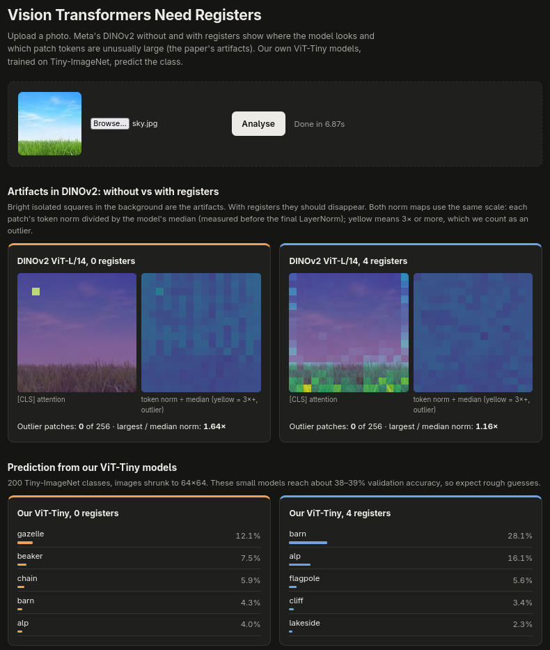

```
curl -s -F "file=@sky.jpg" localhost:8000/predict      # image fields removed below for space
{
  "classification": [
    {"model": "Our ViT-Tiny, 0 registers", "validation_accuracy": 0.3899,
     "top5": [{"class": "gazelle", "probability": 0.121}, {"class": "beaker", "probability": 0.0748}, ...]},
    {"model": "Our ViT-Tiny, 4 registers", "validation_accuracy": 0.3786,
     "top5": [{"class": "barn", "probability": 0.2813}, {"class": "alp", "probability": 0.1607}, ...]}
  ],
  "artifacts": [
    {"model": "DINOv2 ViT-L/14, 0 registers", "registers": 0, "outlier_patches": 0,
     "total_patches": 256, "largest_over_median_norm": 1.64},
    {"model": "DINOv2 ViT-L/14, 4 registers", "registers": 4, "outlier_patches": 0,
     "total_patches": 256, "largest_over_median_norm": 1.16}
  ],
  "filename": "sky.jpg",
  "seconds": 8.22
}
```

What it shows:
- **Attention:** without registers, DINOv2's [CLS] token puts most of its attention on one patch of empty sky (the bright square), which is the paper's artifact (Fig 1). With registers the attention moves to the grass, the only real content in the photo.
- **Norms:** neither ViT-L model has a patch above 3x the median, but the largest norm is still higher without registers (1.64x vs 1.16x). This matches Part A, where ViT-L had no outliers (largest 1.71x) and only ViT-g had many (2.62%, largest 11.3x). So the app shows the artifact through attention for L, and through norms only for G (`DINOV2_SIZE=G`, about 9 GB of RAM).
- **Our classifiers:** the sky photo has no Tiny-ImageNet class, so the guesses are scenery classes (barn, alp, cliff). On a photo of a spider web both models answer "spider web" (30% without registers, 61% with).
<!-- DEPLOYMENT_EXAMPLE_END -->

**Tests:** `tests/test_app.py` starts the app with stand-in models and checks every endpoint (including bad uploads); it runs automatically on every push.

## 9. Differences from the paper

**Changes from our proposal**

- We use only DINOv2, not CLIP. Meta released DINOv2 models trained both with and without registers, but no CLIP model with registers exists publicly, so a before/after comparison is only possible for DINOv2.
- We load the models from Meta's official repository through PyTorch Hub instead of HuggingFace. These are the same weights from the original source.
- For Part A we use Imagenette validation images (object-centred photos, similar to the paper's figures), since the DINOv2 models expect larger images than Tiny-ImageNet's 64x64.

**Differences from the paper's setup**

- **Model sizes in Part A:** The paper's Fig 4c compares DINOv2 models trained separately at each size. Meta's *released* ViT-S/B/L were distilled from ViT-g, so the size trend in our Part A is measured on distilled models. This may differ from the paper's trend.
- **Images:** 256 Imagenette validation images at 224x224 (16x16 patches), not the paper's image set or resolution.
- **Outlier cutoff:** a fixed relative rule (3 × the model's median norm) instead of a hand-picked value per model. For ViT-g we also report the paper's cutoff of 150.
- **Learning rate:** our ViT-Tiny runs in section 5 used 1e-3; the experiment uses 2.5e-4 for every size because 1e-3 broke ViT-Base (section 7). The paper's own models use their published recipes.
- **Training method in Part B:** our ViTs are trained with labels (supervised classification), like the paper's DeiT-III models, not self-supervised like DINOv2.
- **Part B scale:** ViTs of 5.4M–85.4M parameters trained from scratch on 100,000 images of 64x64 for 50 epochs. The paper trains ViT-B/L/g on ImageNet-22k or larger datasets for much longer. The paper reports that artifacts only appear in large, long-trained models (Fig 4); our experiment (section 7) confirms that our models show none.

## 10. Limitations

- **Compute:** Google Colab GPUs (T4, L4 and A100 when available). We cannot train models of the paper's size or on its data, so Part A uses Meta's released models and our own models stop at ViT-Base size on 100,000 images. Some runs moved between GPU types or were resumed from their last saved epoch after a disconnect (ViT-Tiny with registers in section 5 after epoch 14; the first, failed ViT-Base with registers after epoch 4). Resuming changes the order of the training images afterwards. The six experiment runs at 2.5e-4 ran without interruption.
- **Released models:** Meta's ViT-S/B/L were distilled from ViT-g, so Part A's model-size trend is not a clean test of the paper's Fig 4c.
- **One seed per setting:** accuracy differences of up to about one point between our runs may be random. More seeds would tell us whether the small register effects are real.
- **One learning rate, chosen by a rule:** we did not tune hyper-parameters per model. 2.5e-4 trains all sizes stably, but each size might do better with its own learning rate or with stronger augmentation.
- **Overfitting:** our larger models reach 97–99% training accuracy against about 40% on validation; ViT-Tiny reaches 73%. Tiny-ImageNet's 100,000 images are too few for these models, which also limits how far we can push model size.
- **Training length:** artifacts in the paper appear only after long training (Fig 4b). 50 epochs on 100,000 images is far shorter than DINOv2's training, so our experiment cannot separate the effect of model size from the effect of training length.
- **Not tested:** the paper's claim that high-norm tokens hold global rather than local information (Table 1, Fig 5b), and the benefits of registers on dense tasks and object discovery (Tables 2a, 3). These need linear probes or segmentation/LOST pipelines on large pretrained models, which did not fit our time and compute budget.
- **Sample sizes:** 256 Imagenette images for Part A and 2,000 validation images for the experiment. Enough to see the effects clearly, but percentages would shift a little with other images.
- **Deployment:** the app runs on CPU. DINOv2-L takes about 8 s per image, and the giant model, the only one with clear norm outliers, needs about 9 GB of RAM. Our classifiers know only 200 classes at 64x64, so their predictions on everyday photos are rough.

## 11. Conclusion

**Reproduction.** The paper's diagnosis holds on the models it studied. In Meta's DINOv2 ViT-g, 2.62% of patch tokens have a very large norm (paper: 2.37%); they sit on redundant background patches; registers remove them (2.62% → 0.00%) and clean up the attention maps; and the large values move into the registers. One detail matters a lot in practice: the norms must be read before the model's final LayerNorm, which otherwise hides them. The size claim is only partly reproduced on the released models (clear outliers only in ViT-g), most likely because Meta's smaller released models were distilled from ViT-g.

**Implementation.** Our own ViT with registers, written from scratch, trains normally with and without registers, and adding registers changes accuracy by about a point or less, in line with the paper.

**Experiment.** Small ViTs trained from scratch on Tiny-ImageNet (5M–85M parameters) show no high-norm artifacts at all, and in them the registers receive only the attention an average token would get (5.7–6.2% against 5.8%). This supports the paper's explanation: registers are scratch space that a model only starts to use once it is large and trained long enough to need it. Below that point registers are harmless but idle. A side result is that the shared learning rate of 1e-3 broke ViT-Base and hurt ViT-Small, so comparisons across model sizes need a learning rate that suits the largest model.

**Deployment.** A FastAPI web app and JSON API (section 8) let anyone upload a photo and see, side by side, how DINOv2's attention changes with registers, together with our own model's prediction.

**What we would do next:** train our models for longer or on more data to find where artifacts first appear; repeat each run with several seeds; and test the paper's downstream claims (linear probing of high-norm tokens, LOST object discovery) on the released DINOv2 models.

## 12. Provenance

See [PROVENANCE.md](PROVENANCE.md) for a file-by-file record of what was written for this project, what was adapted, and what was reused.

## References

- Darcet, T., Oquab, M., Mairal, J., Bojanowski, P. *Vision Transformers Need Registers.* ICLR 2024.
- Dosovitskiy, A. et al. *An Image is Worth 16x16 Words: Transformers for Image Recognition at Scale.* ICLR 2021.
- Burtsev, M. et al. *Memory Transformer.* arXiv:2006.11527, 2020.
- Sandler, M. et al. *Fine-tuning Image Transformers using Learnable Memory.* CVPR 2022.
- Caron, M. et al. *Emerging Properties in Self-Supervised Vision Transformers (DINO).* ICCV 2021.
- Siméoni, O. et al. *Localizing Objects with Self-Supervised Transformers and no Labels (LOST).* BMVC 2021.
- Oquab, M. et al. *DINOv2: Learning Robust Visual Features without Supervision.* TMLR 2024. Code and weights: https://github.com/facebookresearch/dinov2
- He, K. et al. *Masked Autoencoders Are Scalable Vision Learners (MAE).* CVPR 2022.
- Touvron, H. et al. *Training data-efficient image transformers & distillation through attention (DeiT).* ICML 2021.
- Sun, M., Chen, X., Kolter, J. Z., Liu, Z. *Massive Activations in Large Language Models.* COLM 2024. arXiv:2402.17762
- Yang, J. et al. *Denoising Vision Transformers.* ECCV 2024. arXiv:2401.02957
- Jiang, N., Dravid, A., Efros, A. A., Gandelsman, Y. *Vision Transformers Don't Need Trained Registers.* NeurIPS 2025. arXiv:2506.08010
- Le, Y., Yang, X. *Tiny ImageNet Visual Recognition Challenge.* CS231N, 2015.
- Imagenette: https://github.com/fastai/imagenette
